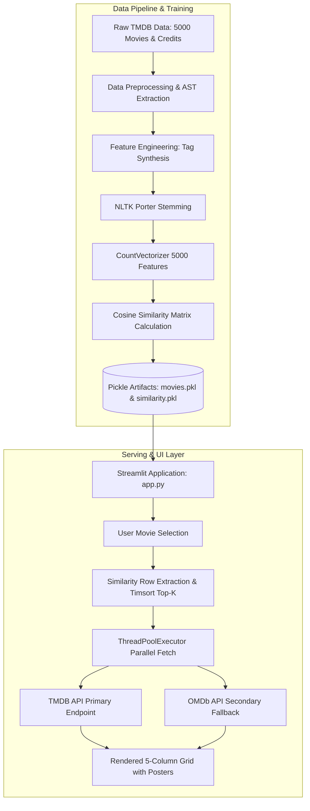

<div align="center">

# 🎬 CineMatch: Content-Based Movie Recommendation Engine

An end-to-end Machine Learning web application delivering personalized movie suggestions using Natural Language Processing (NLP) metadata engineering, cosine similarity indexing, and parallelized multi-tier asset hydration.

[](https://www.python.org/)
[](https://streamlit.io/)
[](https://scikit-learn.org/)
[](https://git-lfs.com/)

[](LICENSE)

</div>

---

## 📌 Table of Contents
- [Overview](#-overview)
- [System Architecture](#-system-architecture)
- [Key Features](#-key-features)
- [Repository Structure](#-repository-structure)
- [Machine Learning Pipeline](#-machine-learning-pipeline)
- [Performance & Latency Optimizations](#-performance--latency-optimizations)
- [Local Installation & Setup](#-local-installation--setup)
- [Docker Deployment](#-docker-deployment)
- [Environment Variables & Configuration](#-environment-variables--configuration)
- [License](#-license)

---

## 📖 Overview

**CineMatch** recommends feature films by modeling relationships between text descriptions, genres, plot keywords, lead cast members, and directors from the **TMDB 5,000 Movie Dataset**. 

Unlike collaborative filtering approaches that suffer from user cold-start issues, CineMatch implements a **content-based filtering** architecture. Raw textual descriptors are extracted, normalized with Porter Stemming, vectorized into a 5,000-dimensional sparse feature space, and evaluated using pairwise cosine similarity metrics.

---

## 🏗️ System Architecture



---

## ✨ Key Features

- **Content-Based Filtering:** Analyzes movie overview text, top 3 billed actors, director, and genre tags to calculate semantic closeness.
- **Git LFS Integrated:** Manages large precomputed binary matrices ($>175\text{ MB}$) using Git Large File Storage pointer protocols.
- **Concurrent Asset Retrieval:** Dispatches poster requests via Python `ThreadPoolExecutor` to minimize network wait times.
- **Defensive Multi-Tier API Fallback:** Implements primary queries to TMDB, fallback lookups via URL-encoded titles to OMDb, and deterministic static fallbacks for unlisted films.
- **Dual-Tier Streamlit Caching:** Uses `@st.cache_resource` for global in-memory singleton matrix residency and `@st.cache_data` for zero-latency poster memoization.

---

## 📂 Repository Structure

```text
Movie-Recommendation-System/
├── .gitattributes             # Git LFS tracking rules for *.pkl artifacts
├── .gitignore                # Environment, cache, and artifact exclusions
├── README.md                 # Project documentation
├── requirements.txt          # Python dependencies
│
├── app/
│   └── app.py                # Streamlit UI and execution entrypoint
│
├── artifacts/
│   ├── movies.pkl            # Processed Pandas DataFrame metadata (Git LFS)
│   └── similarity.pkl        # 4806 x 4806 cosine similarity matrix (Git LFS)
│
├── data/
│   ├── tmdb_5000_credits.csv # Cast, crew, and production credits
│   └── tmdb_5000_movies.csv  # Movie overviews, genres, budget, and keywords
│
├── notebooks/
│   └── Movie_recommendation.ipynb  # Exploratory data analysis and model training
│
└── src/
    ├── __init__.py           # Package marker
    └── recommendation.py     # Core inference algorithms
```

---

## 🔬 Machine Learning Pipeline

### 1. Data Cleaning & Feature Extraction
* Merged `tmdb_5000_movies.csv` and `tmdb_5000_credits.csv` on movie title attributes.
* Extracted structured entities from nested JSON string fields using `ast.literal_eval`:
  * **Genres & Keywords:** Converted stringified lists into normalized keyword tokens.
  * **Cast:** Filtered for the top 3 billed actors.
  * **Crew:** Extracted the designated `Director`.

### 2. Entity Representation & Space Collapse
To prevent token conflation across common first names (e.g., *Sam Worthington* vs. *Sam Mendes*), whitespace was removed from all multi-word entity strings:
```python
"Sam Worthington" -> "SamWorthington"
"Science Fiction" -> "ScienceFiction"
```

### 3. NLP Normalization & Vectorization
* Aggregated tokens into a unified string column: $\text{Tags} = \text{Overview} + \text{Genres} + \text{Keywords} + \text{Cast} + \text{Crew}$.
* Normalized tokens with Porter Stemming from `nltk` to reduce inflectional forms (e.g., `["loved", "loving"] -> "love"`).
* Generated bag-of-words document vectors using Scikit-Learn's `CountVectorizer`:
  * `max_features=5000`
  * `stop_words='english'`

### 4. Similarity Calculation
Pairwise angles between document vectors are calculated via **Cosine Similarity**:

$$\text{Cosine Similarity}(u, v) = \frac{u \cdot v}{\|u\|_2 \|v\|_2} = \frac{\sum_{i=1}^{n} u_i v_i}{\sqrt{\sum_{i=1}^{n} u_i^2} \sqrt{\sum_{i=1}^{n} v_i^2}}$$

Inference evaluates the precomputed row corresponding to the chosen movie index and extracts the indices containing the top 5 highest scalar scores.

---

## ⚡ Performance & Latency Optimizations

1. **Parallelized I/O Bound Execution:**
   Sequential network calls across 5 recommendations require $\sim 5 \times t$ latency. Replacing linear requests with `ThreadPoolExecutor(max_workers=5)` dropped overall poster fetching times to $\sim 1 \times t$ ($\le 900\text{ ms}$).
2. **Deterministic URL Encoding:**
   Spaces and special characters in movie titles are escaped using `urllib.parse.quote()` before hitting fallback endpoints, eliminating HTTP 400 parsing errors on multi-word titles.
3. **Memory Footprint Optimization:**
   The $4806 \times 4806$ similarity matrix is retained in application memory via `@st.cache_resource`, avoiding expensive repetitive disk de-serialization.

---

## 💻 Local Installation & Setup

### Prerequisites
* Python 3.10 or higher
* [Git Large File Storage (Git LFS)](https://git-lfs.com/) installed on your machine

### 1. Clone Repository & Initialize Git LFS
```bash
git clone https://github.com/Thippareddy-V/Movie-Recommendation-System.git
cd Movie-Recommendation-System
git lfs install
git lfs pull
```

### 2. Configure Virtual Environment
* **Linux / macOS:**
  ```bash
  python3 -m venv .venv
  source .venv/bin/activate
  ```
* **Windows (PowerShell):**
  ```powershell
  python -m venv .venv
  .\.venv\Scripts\Activate.ps1
  ```

### 3. Install Dependencies
```bash
python -m pip install --upgrade pip
pip install -r requirements.txt
```

### 4. Run Application
```bash
python -m streamlit run app/app.py
```
Open [http://localhost:8501](http://localhost:8501) in your browser.

---


## 🔑 Environment Variables (.env)

The application accesses API credentials securely via a `.env` file.

1. Create a `.env` file in the root directory:

   ```
   touch .env
   
   ```

2. Add your API keys:

   ````
   TMDB_API_KEY=your_tmdb_api_key_here
   
  
   OMDB_API_KEY=your_omdb_api_key_here
   
   ````

3. *(Optional)* Get free API keys from:

   * TMDB API: [themoviedb.org](https://www.themoviedb.org/documentation/api)

   * OMDb API: [omdbapi.com](https://www.omdbapi.com/apikey.aspx)


## 📄 License

This repository is distributed under the **MIT License**. Refer to the [LICENSE](LICENSE) file for complete terms and permissions.